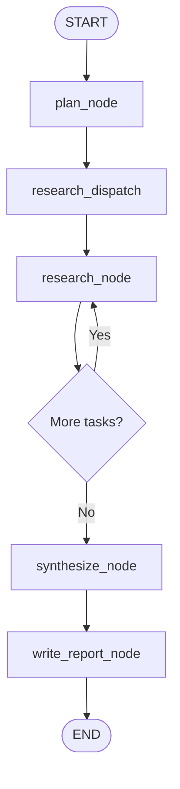

# Research Agent: Architecture, Data Flow, and Implementation Guide

A practical guide to understanding, extending, and reusing the research-agent pipeline built with Python, Azure OpenAI, Pydantic, and the Responses API.

## 1. What this project does

The research agent accepts a broad research question, breaks it into smaller questions, researches each question using web search, combines the results, and saves a Markdown report.

Example question:

> Research production AI agents in 2026. Compare workflow control, reliability, and evaluation.

The agent does not rely on one giant prompt to do everything. Instead, it separates the work into components with clear responsibilities.

### Main stages

1. **Planner** — turns the user's question into a list of focused research tasks.
2. **Researcher** — researches one task and returns structured findings.
3. **Orchestrator** — controls the order of execution, loops over tasks, and records failures.
4. **Context preparation** — packages research results and creates a deduplicated source catalogue.
5. **Synthesizer** — combines the results into a structured report.
6. **Report writer** — writes the final report to a Markdown file.

The orchestrator is the control-flow component. The planner is the first reasoning component that runs inside the orchestrator.

---

## 2. Architecture at a glance

```mermaid
flowchart TD
    A[User research question] --> B[main.py]
    B --> C[Orchestrator: run_research]
    C --> D[Planner: plan_research]
    D --> E[List of research tasks: list[str]]
    E --> F{For each task}
    F --> G[Researcher: research_topic]
    G --> H{Research succeeds?}
    H -- Yes --> I[Store structured ResearchData]
    H -- No --> J[Record task and error]
    I --> F
    J --> F
    F --> K[Successful results + failed tasks]
    K --> L[prepare_research_context]
    L --> M[Research JSON context]
    L --> N[Deduplicated source catalogue]
    M --> O[Synthesizer: synthesize_research]
    N --> O
    O --> P[Structured FinalReport]
    P --> Q[Report writer: save_report]
    N --> Q
    Q --> R[outputs/research_report.md]
```

### Who does what?

| Component | Responsibility | Input | Output |
|---|---|---|---|
| `main.py` | Starts and connects the workflow | User's question | Final saved report |
| `planner.py` | Decomposes the question | Question string | `list[str]` |
| `researcher.py` | Investigates one task | Task string | `ResearchData` |
| `orchestrator.py` | Runs tasks and handles per-task failures | Question string | Successful results and failures |
| `prepare_research_context()` | Packages results and maps sources | Results and failures | JSON context and source catalogue |
| `synthesize_research()` | Produces an integrated report | Question, context, catalogue | `FinalReport` |
| `save_report()` | Serializes the report as Markdown | `FinalReport`, source catalogue | File path |

The orchestration module does not need to be an LLM. It can be ordinary Python that calls the planner, researcher, and synthesizer in a controlled sequence.

---

## 3. Suggested project structure

```text
research-agent/
├── .env
├── .gitignore
├── requirements.txt
├── agent/
│   ├── __init__.py
│   ├── planner.py
│   ├── researcher.py
│   ├── orchestrator.py
│   ├── synthesizer.py
│   └── main.py
└── outputs/
    └── research_report.md
```

Responsibilities:

- `.env`: local credentials and configuration; do not commit it.
- `planner.py`: planner prompt, structured task generation, and task validation.
- `researcher.py`: Azure OpenAI client, research schema, web-search call, and source extraction.
- `orchestrator.py`: loops over tasks and separates successes from failures.
- `synthesizer.py`: report schemas, context preparation, synthesis, validation, and Markdown output.
- `main.py`: application entry point; connects the pieces.
- `outputs/`: generated reports.

As the project grows, you can move shared client/configuration into `config.py` or `client.py`, and schemas into `schemas.py`. Do that when it reduces duplication, not just to create more files.

---

## 4. Step 1 — Start in `main.py`

`main.py` is the entry point. It receives or defines the user's question and invokes the workflow.

Conceptually:

```python
question = "Research production AI agents in 2026."

run = run_research(question)
```

The call to `run_research()` enters the orchestrator. The orchestrator then calls the planner.

This distinction matters:

- **Application entry point:** `main.py`
- **First component called by the orchestrator:** planner
- **Control-flow owner:** orchestrator
- **First reasoning step:** planner

In a future LangGraph version, the application may call `graph.invoke(initial_state)`. The graph itself can start at the planner node. You do not automatically need a separate “orchestrator node” in LangGraph because the graph's edges and routing already control execution.

---

## 5. Step 2 — Planner: turn a broad question into tasks

### Purpose

The planner converts one broad question into a manageable list of research questions.

Example:

```python
[
    "Compare fixed workflows and dynamically planned AI agents.",
    "Identify reliability techniques used in production AI agents.",
    "Compare methods for evaluating AI agent quality.",
]
```

The planner's return type in this project is:

```python
list[str]
```

Each string represents one independent research task.

### Why separate planning from research?

Planning and research are different responsibilities:

- Planning decides **what needs to be investigated**.
- Research decides **what evidence can be found about one task**.

This makes the system easier to debug and reuse. You can change the planning prompt without rewriting the researcher.

### Validation to consider

Before returning tasks, validate that:

- The result is a list.
- The list is not empty.
- Each task is a non-empty string.
- The number of tasks is bounded, for example 3–5.
- Tasks are relevant to the original question and do not repeat one another.

A planner that returns malformed tasks should fail early with a useful error rather than passing bad data downstream.

---

## 6. Step 3 — Researcher: research one task

### Purpose

The researcher takes one task string, performs a web-search-enabled model call, and returns a structured `ResearchData` object.

Conceptually:

```python
result = research_topic(
    "Identify reliability techniques used in production AI agents."
)
```

The researcher should not be responsible for looping over every task or writing the complete final report. Those responsibilities belong to the orchestrator and synthesizer.

### Structured output

The current research schema is conceptually similar to:

```python
class SourceReference(BaseModel):
    title: str
    url: HttpUrl
    relevance: str


class ResearchData(BaseModel):
    research_findings: str
    summary: str
    sources: list[SourceReference]
    limitations: list[str]
```

Use the exact field names from the schema in your project. Earlier versions of the prototype used a misspelled `resarch_findings`; standardize on `research_findings`.

### What the researcher does

1. Receives one task.
2. Sends the task and research instructions to Azure OpenAI.
3. Uses the Responses API with the web-search tool.
4. Parses the result into the Pydantic schema.
5. Checks that a structured result was returned.
6. Returns `ResearchData` to its caller.

### Source integrity

Do not assume a URL is valid simply because the model generated it. Prefer extracting actual web-search citation metadata from the API response and using that metadata to populate the source catalogue. Keep source metadata attached to the relevant findings so later stages can trace claims back to evidence.

The presence of a citation alone does not prove that the source supports a particular claim. A production system should check source relevance and factual support.

---

## 7. Step 4 — Orchestrator: coordinate all research tasks

### Purpose

The orchestrator controls the execution of the planner and researcher. It is ordinary Python, not necessarily an LLM.

Its sequence is:

1. Call `plan_research(question)`.
2. Receive `tasks: list[str]`.
3. Loop over the tasks.
4. Call `research_topic(task)` for each task.
5. Save successful results.
6. Record failed tasks and error messages.
7. Return both collections to `main.py`.

The return value is conceptually:

```python
{
    "successful_results": [
        {
            "task": "Research task text",
            "result": ResearchData(...),
        }
    ],
    "failed_tasks": [
        {
            "task": "A task that failed",
            "error": "Error message",
        }
    ],
}
```

### Why record failures separately?

If one research task fails, you usually do not want to discard all the successful work. Recording failures allows the pipeline to continue and lets the final report disclose incomplete coverage.

The basic implementation catches exceptions around each task. That is a useful first step, but it is not a complete retry policy. Later, classify errors:

- Temporary network or service errors: may be retried with a limit and backoff.
- Rate limits: may need a delay and retry.
- Authentication or invalid deployment configuration: should generally fail clearly instead of retrying indefinitely.
- Invalid structured output: may merit a bounded repair attempt or a recorded failure.

Avoid silently swallowing exceptions. Log enough information to debug the failure without exposing API keys or sensitive data.

### Sequential versus parallel research

The current implementation is sequential: task 2 starts after task 1 finishes. This is easy to understand and debug.

Later, independent tasks can run concurrently, using bounded parallelism. Parallel execution can reduce latency but introduces more concerns: rate limits, ordering, partial failures, and resource usage.

---

## 8. Step 5 — Prepare the research context and source catalogue

Before synthesis, raw Python objects need to be transformed into a consistent payload for the model and a source catalogue for the final report.

The helper `prepare_research_context()` returns two values:

```python
research_context, source_catalogue = prepare_research_context(
    successful_results,
    failed_tasks,
)
```

### Output A: `research_context`

This is a JSON string containing the task results, validated source metadata, and failed-task information. It is the evidence packet passed into the synthesizer.

### Output B: `source_catalogue`

This is a list of `ReportSource` objects with stable IDs such as `S1`, `S2`, and `S3`.

Example:

```python
[
    ReportSource(
        source_id="S1",
        title="Example article",
        url="https://example.com/article",
    ),
]
```

The source catalogue deduplicates sources by URL so that the same source does not get a new ID every time it appears in a different research task.

### Why source IDs?

The report can refer to `[S1]` instead of repeating a long URL after every claim. The Markdown writer then resolves those IDs to the source list at the end of the report.

Source IDs are internal references, not proof of factual accuracy. Keep the mapping stable throughout a single run.

### Why prepare context only once?

The recommended flow calls `prepare_research_context()` once in `main.py` and passes both outputs to synthesis and report writing.

```python
research_context, source_catalogue = prepare_research_context(
    run["successful_results"],
    run["failed_tasks"],
)

report = synthesize_research(
    question=question,
    research_context=research_context,
    source_catalogue=source_catalogue,
    failed_tasks=run["failed_tasks"],
)

path = save_report(report, source_catalogue)
```

Do not call the preparation helper again inside synthesis if the caller has already prepared the context. Otherwise, the same data is transformed twice and the source catalogue is rebuilt unnecessarily.

For a small run, duplicate preparation is mostly wasted processing rather than a major cost. The larger design concern is avoiding inconsistent source-ID mappings if the source set or deduplication logic changes between calls.

---

## 9. Step 6 — Synthesizer: integrate the evidence

### Purpose

The synthesizer combines the separate research results into one answer to the original question.

It should not merely paste summaries together. It should:

- Identify themes that appear across multiple tasks.
- Remove duplication.
- Compare approaches or findings.
- Highlight disagreements and uncertainty.
- Identify missing evidence.
- Make recommendations that follow from the collected evidence.
- Preserve source traceability.
- Acknowledge failed tasks and research limitations.

### Input

The synthesizer receives:

- The original question.
- The prepared JSON research context.
- The source catalogue.
- Failed-task information.

The source catalogue is used for local validation. The JSON context contains the catalogue metadata and research results that are supplied to the model.

### Output schema

The final report schema is conceptually:

```python
class ReportSource(BaseModel):
    source_id: str
    title: str
    url: str


class ReportSection(BaseModel):
    heading: str
    content: str
    source_ids: list[str]


class Recommendation(BaseModel):
    recommendation: str
    rationale: str
    source_ids: list[str]


class FinalReport(BaseModel):
    title: str
    executive_summary: str
    key_findings: list[str]
    sections: list[ReportSection]
    recommendations: list[Recommendation]
    evidence_gaps: list[str]
    limitations: list[str]
```

### Why structured output again?

The researcher and synthesizer have different output contracts:

- Researcher output: findings about one task.
- Synthesizer output: integrated report with sections and recommendations.

Pydantic provides a predictable structure for downstream code and helps catch malformed output.

### Validate the source IDs

After synthesis, compare every source ID in the report sections and recommendations against the catalogue:

```python
valid_ids = {source.source_id for source in source_catalogue}
```

If the model invents an ID, reject the result or repair it through a controlled validation step. Do not silently add unknown sources to the catalogue.

This validation catches nonexistent IDs, but not unsupported claims. Stronger evaluations should verify that each cited source actually supports the corresponding claim.

---

## 10. Step 7 — Write the final Markdown report

The report writer takes the structured `FinalReport` and the same source catalogue used during synthesis.

It converts the data into a readable document with:

1. Title
2. Executive summary
3. Key findings
4. Detailed sections
5. Recommendations and rationale
6. Evidence gaps
7. Limitations
8. Sources

The final output is written to:

```text
outputs/research_report.md
```

The report writer should not call the model. Its job is deterministic formatting and file output. Keeping generation separate from formatting makes it easier to test and change the report layout.

---

## 11. Full data flow, from start to finish

Consider this execution:

```python
question = "Compare reliability techniques for production AI agents."

run = run_research(question)
```

### Data flow table

| Step | Data before | Operation | Data after |
|---|---|---|---|
| 1 | Question string | Planner decomposes question | `list[str]` tasks |
| 2 | One task string | Researcher performs search and parses output | `ResearchData` |
| 3 | Tasks + research calls | Orchestrator collects outcomes | Successful results + failed tasks |
| 4 | Research objects | Context preparation serializes and deduplicates | JSON context + source catalogue |
| 5 | Question + context + catalogue | Synthesizer produces integrated answer | `FinalReport` |
| 6 | `FinalReport` + catalogue | Markdown writer formats and saves | File path |

A simplified version of the application entry point is:

```python
def main():
    question = "Your research question"

    # Plan and research.
    run = run_research(question)

    if not run["successful_results"]:
        print("No research succeeded.")
        return

    # Prepare data once.
    research_context, source_catalogue = prepare_research_context(
        run["successful_results"],
        run["failed_tasks"],
    )

    # Synthesize.
    report = synthesize_research(
        question=question,
        research_context=research_context,
        source_catalogue=source_catalogue,
        failed_tasks=run["failed_tasks"],
    )

    # Save.
    path = save_report(
        report,
        source_catalogue,
        output_path="outputs/research_report.md",
    )

    print(f"Saved report to: {path.resolve()}")
```

The exact signatures should match the versions in your current project.

---

## 12. Implementation flow: how to build a similar project from scratch

When building another multi-step AI system, implement it in this order.

### Phase 1 — Define the problem and contracts

Before writing API calls, define:

- The input to the system.
- The expected final output.
- Each component's responsibility.
- The input and output type of every component.
- How failures should be represented.

For example:

```text
Question: str
Planner: str -> list[str]
Researcher: str -> ResearchData
Orchestrator: str -> RunResults
Context preparation: RunResults -> (JSON context, SourceCatalogue)
Synthesizer: Question + context -> FinalReport
Writer: FinalReport + SourceCatalogue -> Path
```

This makes interfaces explicit and reduces accidental coupling between modules.

### Phase 2 — Build and test components independently

1. Test the planner with a fixed question.
2. Test the researcher with one task.
3. Test the researcher schema with sample structured data.
4. Test the orchestrator with a mocked researcher, including a simulated failure.
5. Test source deduplication with repeated URLs.
6. Test synthesis with a small, known set of findings.
7. Test Markdown output without calling the model.

Use mocked data for most unit tests. It is faster and cheaper than repeatedly calling a live model.

### Phase 3 — Connect the pipeline

Once each component works independently:

1. Connect planner to orchestrator.
2. Connect orchestrator to researcher.
3. Return successful results and failures.
4. Prepare the synthesis context once.
5. Connect the synthesizer.
6. Save the report.
7. Test a full run end to end.

### Phase 4 — Add production controls

After the basic pipeline is stable, add:

- Bounded retries with exponential backoff.
- Timeouts and rate-limit handling.
- Structured logs and run IDs.
- Token usage and cost tracking.
- Token-budget checks and context truncation.
- Parallel research with concurrency limits.
- Caching for repeated tasks.
- Citation relevance checks.
- Evaluation datasets and regression tests.
- Secrets management and safe error reporting.

Do not introduce all of these at once. Add one capability, test it, and measure the effect.

---

## 13. How this maps to LangGraph

Your current implementation is a normal Python workflow. The same concepts can be represented as graph nodes and shared state.

A possible future graph:



This is a conceptual design. In a real LangGraph implementation, independent tasks can be dispatched as parallel workers, and results can be collected into shared state. The exact graph edges depend on whether research is sequential, parallel, or dynamically routed.

A possible shared state might include:

```python
class ResearchState(TypedDict):
    question: str
    tasks: list[str]
    successful_results: list[dict]
    failed_tasks: list[dict]
    research_context: str
    source_catalogue: list[dict]
    final_report: dict | None
    output_path: str | None
```

Each node reads the fields it needs and updates the fields it owns. For example:

- Planner node writes `tasks`.
- Research node writes results and failures.
- Context-preparation node writes `research_context` and `source_catalogue`.
- Synthesizer node writes `final_report`.
- Writer node writes `output_path`.

The graph becomes the control-flow mechanism. You may retain plain Python helper functions inside nodes, but the graph determines which node runs next.

---

## 14. Common mistakes and lessons

### Mistake: putting every responsibility in one large function

**Why it hurts:** prompts, API calls, validation, control flow, and file output become difficult to test independently.

**Better approach:** keep components small and define clear interfaces.

### Mistake: making the planner perform all the research

**Why it hurts:** task decomposition becomes entangled with evidence collection, making failures and output quality harder to isolate.

**Better approach:** let the planner create tasks and the researcher investigate them.

### Mistake: rerunning context preparation unnecessarily

**Why it hurts:** duplicates processing and can make source-ID consistency harder to reason about.

**Better approach:** prepare once and reuse the exact context and catalogue.

### Mistake: treating structured output as fact verification

**Why it hurts:** a schema guarantees a shape, not truth.

**Better approach:** validate IDs and structure, then separately evaluate source relevance and claim support.

### Mistake: losing failed-task information

**Why it hurts:** the report may imply complete coverage even when some research never ran.

**Better approach:** retain failures and make them available to the synthesizer.

### Mistake: adding concurrency before basic error handling

**Why it hurts:** concurrent failures, ordering, and rate limits are harder to diagnose.

**Better approach:** establish reliable sequential behavior first, then add bounded concurrency.

---

## 15. Checklist for understanding the project

You should be able to explain each of these without looking at the code:

- [ ] Why `main.py` is the application entry point.
- [ ] Why the planner returns `list[str]`.
- [ ] Why the researcher handles one task at a time.
- [ ] Why the orchestrator calls the planner and loops over tasks.
- [ ] Why successful results and failed tasks are stored separately.
- [ ] Why research results need a structured schema.
- [ ] Why context preparation returns both JSON and a source catalogue.
- [ ] Why context preparation should run only once per pipeline run.
- [ ] How source IDs connect report sections to the final source list.
- [ ] Why structured output does not guarantee factual accuracy.
- [ ] How the Markdown writer differs from the synthesizer.
- [ ] How the workflow could become a LangGraph state graph.

## Final mental model

Think of the system as a small data-processing pipeline:

**Question → Tasks → Evidence → Collected results → Prepared context → Synthesized report → Markdown file**

Each component has one job, a clear input, and a clear output. The orchestrator controls execution; the planner decides what to investigate; researchers gather evidence; the synthesizer integrates it; and the writer formats the final artifact.

This pattern can be reused for incident analysis, competitive research, literature reviews, market analysis, document investigation, and many other multi-step AI applications.
